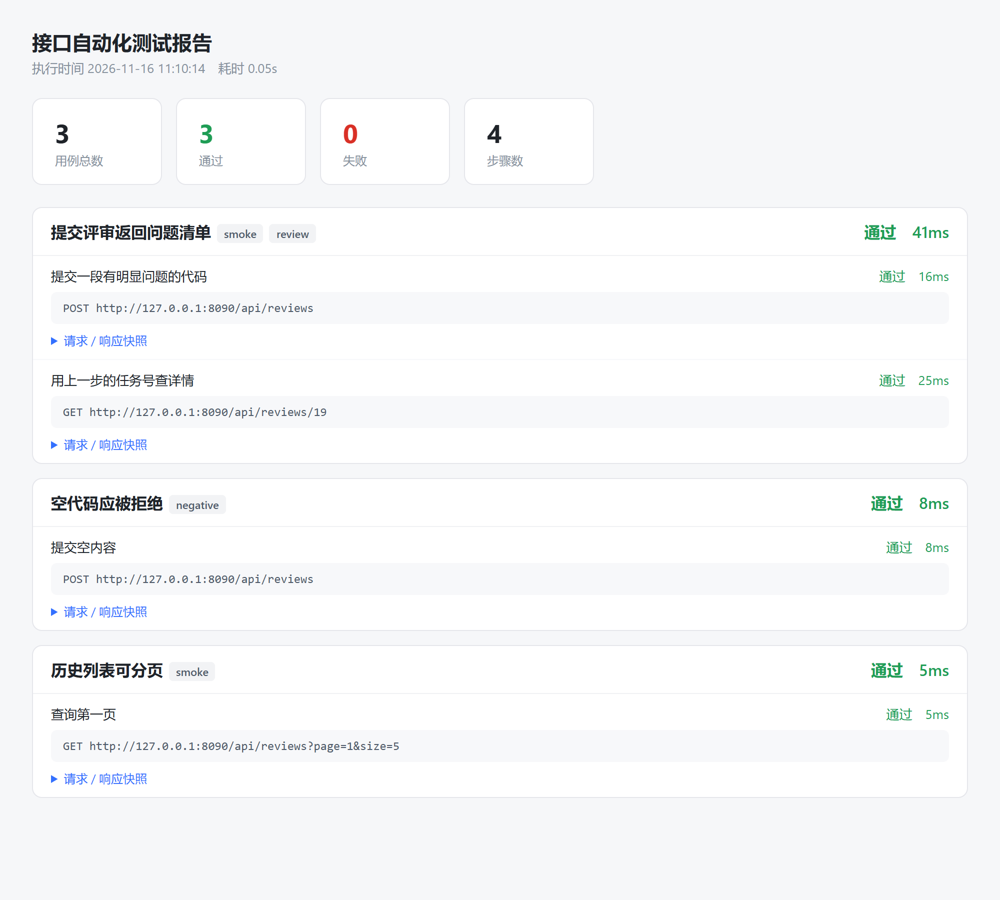

# api-testkit

数据驱动的接口自动化测试框架。用一份 YAML 描述请求、断言和变量传递，执行后输出可定位的 HTML 报告。

不是 pytest 的封装，而是一个自带执行引擎的小框架：用例怎么组织、变量怎么传、失败怎么定位，都是这个项目自己实现的。

## 用例长什么样

```yaml
cases:
  - name: 提交评审返回问题清单
    tags: [smoke, review]
    steps:
      - name: 提交一段有明显问题的代码
        request:
          method: POST
          url: ${base_url}/api/reviews
          headers: ${default_headers}
          json:
            repoName: demo-repo
            fileName: Demo.java
            code: "public class Demo { ... }"
        assert:
          - status:
              expect: 200
          - jsonpath:
              path: data.task.issueCount
              equals: 3
          - response_time:
              max_ms: 5000
        extract:
          task_id: data.task.id

      - name: 用上一步的任务号查详情
        depends_on: 提交一段有明显问题的代码
        request:
          method: GET
          url: ${base_url}/api/reviews/${task_id}
        assert:
          - jsonpath:
              path: data.issues.0.severity
              equals: critical
```

几个设计点：

- `${base_url}` 来自环境文件，同一份用例可以跑在 dev / test / staging 上
- `extract` 把上一步响应里的字段写进上下文，下一步直接用 `${task_id}`
- `depends_on` 声明依赖，前一步失败时后一步标记为跳过，而不是制造一串连锁失败

## 断言

| 类型 | 用途 | 示例 |
|---|---|---|
| `status` | 状态码 | `expect: 200` |
| `jsonpath` | 字段等值 | `path: data.code` / `equals: 0` |
| `gte` | 数值下限 | `path: data.total` / `value: 1` |
| `exists` | 字段存在 | `path: data.issues.0.severity` |
| `contains` | 响应包含文本 | `text: SECRET_HARDCODED` |
| `regex` | 正则匹配 | `pattern: "total\\":\\s*\\d+"` |
| `schema` | JSON Schema 校验 | 见 `cases/smoke.yaml` |
| `response_time` | 响应时间上限 | `max_ms: 5000` |

路径支持 `data.issues.0.severity` 这种数组下标写法，不用引入 jsonpath 依赖。

## 执行

```bash
# 冒烟（不依赖外部服务）
python -m api_testkit.cli run cases/smoke.yaml --env env/dev.yaml

# 并行执行，失败重试一次
python -m api_testkit.cli run cases/smoke.yaml --env env/dev.yaml --workers 4 --retries 1

# 只跑带指定标签的用例
python -m api_testkit.cli run cases/smoke.yaml --tag smoke

# 只列清单，不发请求（--tag 过滤同样生效）
python -m api_testkit.cli run cases/smoke.yaml --list
```

```
cases/smoke.yaml：3 个用例
  提交评审返回问题清单       tag=smoke,review       步骤 2
  空代码应被拒绝             tag=negative           步骤 1
  历史列表可分页             tag=smoke              步骤 1
```

`--list` 是为两个场景加的：一是 CI 里先落一份"用例清单"快照，用例被误删/漏加能立刻看出来；
二是排查"为什么这个用例没跑"——多数情况是被 `--tag` 过滤掉了，而不是文件名写错。

输出：

```
[通过] 提交评审返回问题清单  35ms
[通过] 空代码应被拒绝  4ms
[通过] 历史列表可分页  4ms

用例 3　通过 3　失败 0　耗时 0.06s
报告 reports/report.html
JUnit reports/junit.xml
```

退出码：全部通过返回 0，有失败返回 2，方便直接接 CI。

用例文件本身有问题时（路径写错、YAML 语法错、顶层不是映射、`cases` 不是列表）也是退码 2，
但输出是一行可读的 `错误：...`，而不是 Python traceback——YAML 语法错还会带上出错的行列号：

```bash
$ python -m api_testkit.cli run cases/smoke.yml --list
错误：用例文件不存在：cases/smoke.yml

$ python -m api_testkit.cli run cases/broken.yaml --list
错误：用例文件 YAML 解析失败：cases/broken.yaml（第 2 行第 1 列）
  expected the node content, but found '<stream end>'
```

这样在流水线里日志会直接指出是哪个文件、哪一行读不进来，不需要从 traceback 里翻调用栈。

## 报告



HTML 报告包含用例与步骤两级结果、失败原因、请求响应快照（可折叠）、耗时统计。同时生成 JUnit XML，GitHub Actions 等平台能直接解析。

失败时报告里会明确给出期望值与实际值：

```
data.task.issueCount 期望 3，实际 1
响应不包含 'SECRET_HARDCODED'
```

## 被测对象

用例默认打 `code-review-agent`（本仓库同级目录），它有一套真实的多步骤接口：提交评审 → 拿任务号 → 查详情。正好用来验证变量传递和依赖。

两个用例文件：

| 文件 | 依赖 | 说明 |
|---|---|---|
| `cases/smoke.yaml` | 只依赖后端 | 冒烟，可在任何环境跑 |
| `cases/integration.yaml` | 还需 C++ 静态分析服务 | 验证双来源合并，服务未启动时会失败，属预期 |

## 设计取舍

**为什么自己写引擎而不是用 pytest + requests。** pytest 适合单元测试，接口用例用它的 parametrize 也能写，但用例会散落在 Python 文件里，非开发人员改不动。YAML 驱动的好处是用例和执行分离，加一条用例不需要写代码。

**为什么变量上下文按用例隔离。** 并行执行时如果共用一个全局上下文，两个用例的 `token` 会互相覆盖。每个用例进来新建一个 Context 是唯一的正确做法。

**为什么只对 5xx 重试。** 4xx 是请求本身有问题，重试只会浪费时间和刷日志。5xx 才可能是瞬时故障。

## 已知限制

- 只支持 HTTP/JSON，没有 gRPC、WebSocket
- 没有用例录制，需要手写 YAML
- 数据驱动（参数化）还没做，同一用例跑多组数据需要复制步骤
